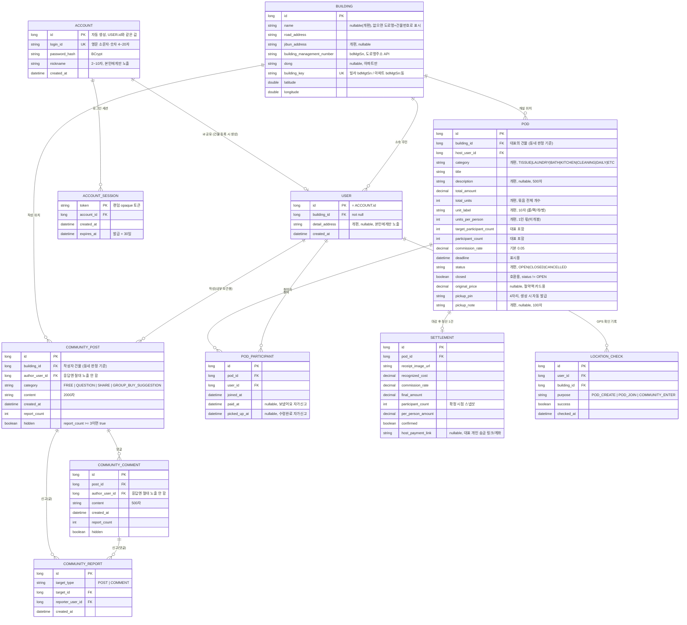

# ERD

> **2026-11 개편**: 계정 테이블(`ACCOUNT`, `ACCOUNT_SESSION`) 추가, `POD`에 카테고리·미개봉 단위·상태 컬럼 추가, `USER`에 상세주소, `BUILDING`에 지번주소 추가. **(개편)** 표시 컬럼은 통합 시 이름이 확정될 수 있습니다. 의미와 규칙은 [PRODUCT_SPEC.md](./PRODUCT_SPEC.md) 7장.

## 메모

- **`ACCOUNT`와 `USER`를 나눈 이유**: `USER`는 "어느 건물 소속인가"이고 `building_id`가 not null이다. 계정은 건물 등록 전에도 있어야 하므로 따로 둔다. `ACCOUNT.id == USER.id`라서 기존 코드의 `userId`(Pod.hostUserId 등)를 그대로 쓸 수 있다. 기존 `users` 테이블 이름(PostgreSQL 예약어 `user` 회피)은 유지.
- **동네 판정**: 테이블에 "동네"를 저장하지 않는다. 요청할 때마다 내 `BUILDING` 좌표와 대상 `BUILDING` 좌표의 거리(≤ 1km)로 계산한다(`NeighborhoodService`). 그래서 `POD.building_id`, `COMMUNITY_POST.building_id`는 그대로 두면 된다.
- **노출 금지 컬럼**: `BUILDING.road_address/jibun_address/name/dong/latitude/longitude`, `USER.detail_address`, `ACCOUNT.nickname`, `*.author_user_id`는 다른 사용자 응답에 넣지 않는다. 다른 사용자에게는 법정동 이름(도로명주소 괄호에서 추출)과 대략 거리만.
- `BUILDING.building_key`는 서버가 계산하는 유니크 키. 상세주소는 키에 쓰지 않는다.
- `LOCATION_CHECK`는 원본 좌표를 저장하지 않고 판정 결과·시각·목적만 남긴다(개인정보 보호).
- 익명 닉네임("이웃 N"/"글쓴이")은 저장하지 않고 응답 조립 시점에 계산한다.
- 스키마는 `ddl-auto: update`로 자동 반영된다. 새 not null 컬럼을 기존 행이 있는 테이블에 추가할 때는 기본값이 필요하다(예: `POD.category`, `POD.status` — 통합 시 확인).
