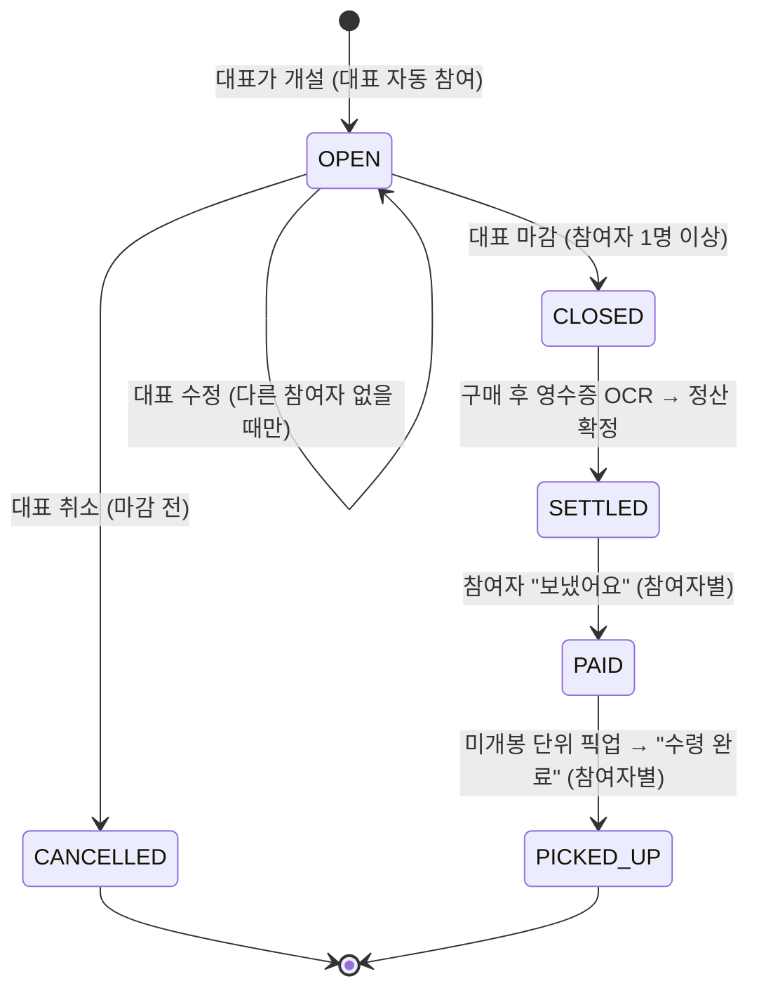

# 소분소분 제품 명세

_작성: 2026-11-04 · 기준: 빌드업 데이 보완계획서(2026.10.03) + 2026-11 보완 작업_

이 문서는 소분소분이 **무엇을, 누구에게, 어떻게** 제공하는지를 한곳에 모은 기준 문서입니다. API 계약은 [API_SPEC.md](./API_SPEC.md), 테이블 구조는 [ERD.md](./ERD.md)를 같이 보세요. 다른 문서와 충돌하면 이 문서를 우선합니다.

> 표기: **(현재)** = 이미 코드에 있는 동작, **(보완)** = 2026-11 보완 작업으로 새로 들어가거나 바뀌는 동작. 보완 항목의 필드 이름·경로는 통합 시점에 최종 확정될 수 있습니다.

---

## 1. 서비스 정의

**소분소분은 같은 건물 이웃끼리 생필품과 밀봉 가공식품을 대용량·묶음으로 함께 사서, 뜯지 않은 단위 그대로 나눠 갖는 하이퍼로컬 공동구매 서비스입니다.**

- 취급 품목: **생필품**(화장지·물티슈, 세탁세제, 샴푸·바디워시, 주방용품, 욕실용품, 청소용품, 생활잡화) + **밀봉 가공식품**(생수·라면 등 상온 보관, 미개봉).
- 취급하지 않는 품목: **식재료**(채소·과일·고기·생선·계란 등 신선식품). 식재료 소분은 위생·보관 리스크가 커서 다루지 않아요. (멘토 피드백 반영)
- 나누는 방식: **미개봉 단위 나눔**. 예) 화장지 30롤 → 1인 10롤씩 3명, 생수 2L×24병(6병×4팩) → 1인 1팩씩 4명.
- 범위: **건물 단위 격리**. 팟·정산·실시간 채널·커뮤니티 모두 같은 건물 주민만 보고 쓸 수 있습니다. 다른 건물 리소스는 ID로 직접 접근해도 403입니다.
- 신뢰 장치: 계정 로그인 + 주소(1차) + 행동 직전 GPS(2차)로 "진짜 이 건물 사람"인지 확인합니다.
- 수익/비용: 참여자에게 플랫폼 수수료를 받지 않습니다. 팟을 연 대표에게는 정산식에 **수고비(기본 5%)** 가 포함됩니다.

## 2. 타깃 사용자

**인하대 근처(인천 미추홀구 용현동·학익동) 빌라·원룸·아파트 주민 전체.** 자취생은 그중 한 집단이고, 기존 설문(자취생 43명)은 초기 검증 집단입니다.

| 사용자 | 상황 | 소분소분에서 얻는 것 |
| --- | --- | --- |
| 1인 가구(자취생·직장인) | 원룸·오피스텔. 대용량이 싼 건 알지만 혼자 다 쓰기 어렵고 보관 공간이 없음 | 묶음가로 필요한 만큼만 |
| 2~3인 소형 가구 | 빌라·아파트. 생수·화장지를 자주 사지만 창고형 마트까지 가기 번거로움 | 이웃이 사 온 물건을 원가+수고비로 |
| 대표(팟장) | 어차피 코스트코·트레이더스에 가는 사람 | 수고비로 이동·구매 노력 보상 |

초기 검증 근거(자취생 43명 설문): 대용량을 샀다가 다 못 쓰고 버린 경험 88%, 최근 1개월 내 폐기 경험 79%, 공동구매를 망설이는 이유 1위는 낯선 이웃과의 접촉 부담(56%). 비자취생 주민 대상 추가 검증은 필요합니다.

주소 등록 지역 제한은 없습니다(전국 허용). 단, 같은 건물 이웃이 있어야 의미가 있으므로 홍보·시연은 용현동·학익동에 집중합니다.

## 3. 핵심 문제

1. **양이 너무 많다**: 화장지 30롤, 생수 24병 같은 묶음은 소형 가구가 다 쓰는 데 오래 걸리고 보관할 곳도 없다.
2. **낯선 사람과 거래하는 부담**: 망설임 이유 1위. 그래서 얼굴을 안 봐도 되는 비대면 픽업, 익명 커뮤니티를 기본으로 한다.
3. **넓은 반경 = 이동 피로**: 중고거래식 동네 인증은 물건 하나 받으러 멀리 가야 한다. 같은 건물로 좁히면 엘리베이터만 타면 된다.
4. **대표가 손해 보는 구조**: 정산·회수를 전담한 대표가 지치면 공구가 끊긴다. 수고비를 정산식에 넣고, 영수증 OCR로 금액 확인을 자동화한다.
5. **식재료 소분은 위험하다**: 냉장·개봉 소분 식품은 위생·보관 분쟁이 생기기 쉽다. 그래서 상하지 않는 품목을 미개봉 단위로만 나눈다.

> **외부 확인 질문 (심사·멘토용, 팀 내부 결정 아님)**: Q. 빌드업 데이 이후 초기 문제 정의(자취생의 대용량 식품 폐기)를 "건물 주민 전체의 생필품·밀봉 가공식품 공동구매"로 넓힌 것이 심사에서 괜찮은지?

## 4. 사용자 시나리오

### 시나리오 A — 자취생 지민이 화장지 30롤을 나눈다 (대표)

1. 지민은 회원가입 후 주소 검색에서 "인하로67번길 3"을 찾아 등록한다. 건물명이 없는 빌라라 표시명은 "인하로67번길 3". 상세주소(302호)는 본인만 보는 값으로 입력한다.
2. 건물 홈에서 [팟 열기] → GPS 확인(건물 반경 20km 안) 통과.
3. 카테고리 "휴지·물티슈", 제목 "코스트코 화장지 30롤", 총액, 총 30롤, 단위 "롤", 1인 10롤, 목표 인원 3명(대표 포함), 수고비 5%, 픽업 안내 "1층 공동현관 앞"을 입력한다. 서버가 10롤 × 3명 ≤ 30롤인지 확인한다.
4. 개설과 동시에 지민이 1번째 참여자가 된다. 1인당 금액이 실시간으로 표시된다.

### 시나리오 B — 같은 건물 이웃 현우가 참여한다 (참여자)

1. 현우는 같은 빌라 2층에 산다. 건물 홈 목록에 "코스트코 화장지 30롤 · 10롤씩"이 보인다(대표가 누구인지, 몇 호인지는 보이지 않는다).
2. [참여하기] → GPS 확인 → 참여 확인 시트에서 "10롤 받아요, 1인당 약 N원"을 확인하고 참여.
3. 참여하는 순간 지민의 화면에서도 참여 인원과 1인당 금액이 바로 바뀐다(WebSocket).
4. 목표 인원이 차면 지민이 [모집 마감]을 누른다.

### 시나리오 C — 생수 2L×24병, 구매·정산·픽업

1. 아파트 101동 주민 수아가 "생수 2L×24병(6병×4팩), 1인 1팩, 4명" 팟을 연다. 모집이 끝나자 마감한다.
2. 생수를 사 와서 정산 화면에서 영수증을 찍는다. OCR이 금액을 읽는다(실패하면 직접 입력).
3. 송금 링크(토스/카카오페이 "받기 링크" 또는 계좌번호)를 붙여 정산을 확정한다.
4. 참여자의 알림 탭에 "정산이 확정됐어요. 1인당 N원을 송금해주세요"가 뜬다. 링크로 송금 후 [보냈어요].
5. 수아는 6병 팩을 뜯지 않은 채 1층 공동현관 앞에 둔다. 참여자는 픽업 화면의 안내를 보고 가져간 뒤 [수령 완료].

### 시나리오 D — 커뮤니티에서 공구를 제안한다

1. 커뮤니티에 "공구 제안"으로 "세탁세제 4L 4개입 같이 사실 분?"을 쓴다. 작성자는 "글쓴이", 댓글 단 이웃은 "이웃 1", "이웃 2"로만 보인다.
2. 반응이 좋자 글 상세의 [이 품목으로 팟 열기]로 팟 개설 화면에 바로 들어간다(GPS 재확인).

### 시나리오 E — 막히는 경우

- 다른 건물 사람이 팟 링크를 받아 열면 "다른 건물의 팟에는 접근할 수 없어요" 안내 화면이 뜬다.
- 학교에서 [참여하기]를 누르면 "지금 위치가 등록한 건물과 달라요. 집에 돌아가서 다시 시도해 주세요" 시트가 뜨고 참여되지 않는다.

## 5. 기능 명세와 우선순위

- **P0**: 데모/제출에 반드시 있어야 하는 것 · **P1**: 이번 보완에서 넣는 것 · **P2**: 여유 있으면, 또는 다음 단계

| 영역 | 기능 | 우선순위 | 상태 |
| --- | --- | --- | --- |
| 계정 | 회원가입(아이디·비밀번호·닉네임), 로그인, 로그아웃, 세션 토큰 | P0 | (보완) |
| 계정 | 새로고침/다른 기기에서 "내 건물" 복구 (`/api/account/me`) | P0 | (보완) |
| 주소 | 도로명/지번 주소 검색 + 더 보기(페이지) | P0 | (보완, 기존 20건 고정) |
| 주소 | 건물명 없는 주택 등록 허용, 아파트 동 선택, 상세주소(선택·비공개) | P0 | (보완) |
| 위치 | 행동 직전 GPS 2차 확인(기본 반경 20km, 임시값), 서버 강제(최근 3분) | P0 | (현재) |
| 격리 | 팟·정산·WebSocket·커뮤니티 같은 건물만, ID 직접 접근도 403 | P0 | (현재) |
| 팟 | 개설(카테고리·미개봉 단위 필드 포함), 참여, 참여 취소, 마감 | P0 | (현재 + 보완 필드) |
| 팟 | 1인당 금액 실시간 갱신(WebSocket) | P0 | (현재) |
| 팟 | 키워드 검색, 카테고리 필터 | P1 | (보완) |
| 팟 | 대표의 수정(다른 참여자 없을 때), 취소(마감 전) | P1 | (보완) |
| 정산 | 영수증 OCR + 수동 입력 fallback, 수고비 반영 정산 확정 | P0 | (현재) |
| 정산 | 송금 링크 표시, "보냈어요" 자가 신고, 대표의 송금 현황 | P0 | (현재) |
| 픽업 | 픽업 안내, "수령 완료" 자가 신고 + 완료 팝업 | P0 | (현재) |
| 커뮤니티 | 건물별 익명 글/댓글("이웃 N"), 카테고리, 삭제, 신고 3회 자동 숨김 | P1 | (현재) |
| 커뮤니티 | 공구 제안 → 팟 열기 연결 | P1 | (현재) |
| 알림 | 앱 안 알림 탭(내 팟 상태에서 "지금 할 일" 계산) | P1 | (현재, 서버 알림 없음) |
| 마이 | 닉네임·내 건물·참여 통계·로그아웃 | P1 | (보완: 계정 정보 연결) |
| 시연 안정성 | `LOCATION_CHECK_DEMO_MODE`, `ADDRESS_DEMO_FALLBACK`, `DEMO_SEED` 환경변수 | P0 | (보완, 12장) |
| 확장 | 개봉 소분, 후기/신뢰도, 결제 연동, 푸시 알림, 인접 건물 확장 | P2 | 10장 |

## 6. 화면별 동작과 예외 상황

공통 규칙:

- **로딩**: 버튼은 비활성화 + 진행 문구("위치를 확인하고 있어요…"), 목록은 "불러오는 중이에요".
- **에러**: 서버 `message`를 그대로 보여주되, 서버가 꺼져 있으면 `client.js`가 "서버에 연결하지 못했어요"로 바꿔준다. [다시 시도] 버튼을 둔다.
- **로그인 만료(401 `UNAUTHORIZED`)** (보완): 저장된 토큰을 지우고 로그인 화면으로 보낸다.
- **다른 건물(403 `BUILDING_ACCESS_DENIED`)**: 일반 에러 대신 `AccessDeniedView` 안내 화면 + [우리 건물 홈으로].
- **건물 미등록**: 로그인은 했지만 `/me`의 `building`이 null이면 주소 검색 화면으로 보낸다.

### 6.1 시작 (`/`)

- 동작: 로고, 한 줄 소개("같은 건물 이웃과 생필품을 묶음가로 나눠요"), [시작하기]/[로그인].
- 이미 로그인 + 건물 등록 완료면 바로 건물 홈(`/home`)으로.
- 예외: 저장된 토큰이 만료됐으면 토큰을 지우고 이 화면에 머문다.

### 6.2 회원가입 (보완)

- 입력: 아이디(영문 소문자·숫자 4~20자), 비밀번호(8자 이상), 비밀번호 확인, 닉네임(2~10자).
- 성공: 바로 로그인 상태(토큰 저장)로 주소 검색 화면 이동.
- 예외: 아이디 중복 → "이미 쓰고 있는 아이디예요". 형식 오류는 제출 전에 프론트에서 먼저 표시하고, 서버도 같은 규칙으로 다시 검사한다.
- 닉네임은 팟/커뮤니티에서 다른 사람에게 보이지 않는다(커뮤니티는 익명 라벨, 팟은 "대표/이웃"으로만 표시). 마이페이지에서 본인만 본다.

### 6.3 로그인 (보완)

- 입력: 아이디, 비밀번호. 성공하면 토큰을 `localStorage`에 저장하고 `/api/account/me`로 내 건물을 받아온다 → 건물 있으면 건물 홈, 없으면 주소 검색.
- 예외: 불일치 → "아이디 또는 비밀번호가 맞지 않아요" (어느 쪽이 틀렸는지 알려주지 않음).
- `localStorage` 접근이 막힌 브라우저: 이번 탭에서만 로그인 유지, "이 브라우저에서는 로그인이 유지되지 않을 수 있어요" 안내.

### 6.4 주소 검색 (`/onboarding/address`)

- 동작: 도로명·지번·건물명으로 검색. 결과 카드에 **표시명**(건물명, 없으면 "도로명 + 건물번호"), 도로명주소, 지번주소.
- (보완) 20건 이상이면 [더 보기]로 다음 페이지. 상단에 "총 N건".
- 빈 결과: "검색 결과가 없어요. 도로명과 건물번호까지 입력해 보세요 (예: 인하로 100)".
- 에러: 주소 API 장애 → 에러 문구 + [다시 검색]. 서버에 `ADDRESS_DEMO_FALLBACK=true`면 장애 시 데모 건물 목록으로 대체된다(시연용). 키가 없는 로컬 환경은 Stub 목록.
- 참고: Juso는 장소명 검색이 아니라 주소 검색이라 "인하대"만 치면 원하는 결과가 안 나올 수 있다 → 입력 힌트에 "도로명 + 건물번호" 예시.

### 6.5 건물 확인 + 상세주소 (`/onboarding/confirm`)

- 동작: 선택한 건물의 표시명·도로명·지번 확인. 아파트면 동 목록(`dongOptions`)에서 선택, 목록이 비면 직접 입력. (보완) 상세주소(호수 등) 선택 입력 — "이웃에게는 보이지 않아요. 내 정보에서만 보여요."
- 성공: 건물 등록(같은 건물이 이미 있으면 합류) → 건물 홈.
- 예외: 좌표 변환 실패 → "이 주소의 위치를 찾지 못했어요. 다른 주소로 검색해 주세요". 건물명 없음은 에러가 아니다(보완).
- 이사: 다시 등록하면 소속 건물만 바뀐다.

### 6.6 건물 홈 — 목록·검색·카테고리 필터 (`/home`)

- 동작: 우리 건물의 모집 중 팟을 최신순으로. 카드에는 카테고리, 제목, 1인 몫("10롤씩"), 1인당 금액, 참여 현황(2/3명).
- (보완) 상단 검색창(제목/설명 키워드) + 카테고리 칩(전체, 휴지·물티슈, 세제·세탁, 샴푸·욕실, 주방용품, 청소용품, 생활잡화, 생수·가공식품, 기타).
- 빈 상태: "아직 우리 건물에 열린 팟이 없어요. 첫 팟을 열어보세요" + [팟 열기]. 검색 결과 없음: "'{키워드}'에 맞는 팟이 없어요".
- 권한: 목록 보기는 건물 등록(1차)만으로 허용, GPS는 묻지 않는다.

### 6.7 팟 개설 (`/pods/new`)

- 진입: [팟 열기] → GPS 2차 확인(`POD_CREATE`) 통과 후 폼. 커뮤니티 공구 제안에서 오면 제목이 미리 채워진다.
- 입력: 카테고리(필수), 제목(필수), 설명(선택, 500자), 총액(필수), 총 개수 `totalUnits`(필수), 단위 `unitLabel`(필수, 10자, 예 "롤·팩·병·개"), 1인 몫 `unitsPerPerson`(필수), 목표 인원(필수, **대표 포함**), 수고비율(기본 5%, 0/3/5/8%), 마감 예정일(선택, 표시용), 픽업 안내 `pickupNote`(선택, 100자, "호수 같은 상세 주소는 적지 마세요").
- 안내: "식재료(채소·고기·계란 등)는 위생·보관 리스크가 커서 올릴 수 없어요. 생수·라면처럼 밀봉된 상온 제품은 괜찮아요."
- 실시간 미리보기: "10롤 × 3명 = 30롤 / 30롤", 예상 1인당 금액.
- 검증 실패: `unitsPerPerson × 목표 인원 > totalUnits`면 "나눌 개수가 전체보다 많아요".
- 예외: GPS 실패 → 실패 시트(6.17). 최근 3분 안의 GPS 통과 기록이 없으면 서버 400 `LOCATION_CHECK_REQUIRED`.
- 성공: 대표가 자동으로 첫 참여자가 되고 팟 상세로 이동.

### 6.8 팟 상세·참여 (`/pods/:podId`)

- 동작: 카테고리, 제목, 설명, 나눔 구성("30롤 중 10롤씩"), 1인당 금액(실시간), 참여 현황, 픽업 안내, 마감 예정일. 대표의 닉네임·호수는 보이지 않는다.
- [참여하기] → GPS(`POD_JOIN`) → 참여 확인 시트(물건 몫/수고비 몫 분리, "마감 전까지 취소할 수 있어요") → 참여. 참여 후 [참여 취소](마감 전).
- 실시간: 다른 사람이 참여/취소하면 인원·1인당 금액이 바로 바뀐다. 연결이 끊기면 "실시간 연결이 끊겼어요. 새로고침하면 최신 금액을 볼 수 있어요".
- 상태별: 모집 완료 → "모집이 끝났어요", 취소됨 → "대표가 취소한 팟이에요", 인원 가득 → "인원이 다 찼어요".
- 예외: 없는 팟 404. 다른 건물 403 → 안내 화면. 마지막 자리 동시 클릭 → 서버가 한 명만 받고 나머지는 "목표 인원이 이미 가득 찼어요"(행 잠금).

### 6.9 참여 현황 (대표)

- 모집 중: 참여 인원·1인당 금액, [모집 마감](참여자 1명 이상). 목표 인원이 다 안 차도 마감할 수 있다(남는 몫 규칙은 9장).
- 정산 후(`/settlements/:podId/payments`): 참여자별 송금·수령 상태. 참여자는 "이웃 1, 이웃 2…" 순번으로만 표시.
- 권한: 참여자별 현황은 대표만.

### 6.10 수정·취소 (보완)

- 수정: 대표만, **대표 말고 다른 참여자가 아직 없을 때만**(participantCount ≤ 1). 개설과 같은 검증. 참여자가 있으면 [수정]을 숨기고 "이웃이 참여한 뒤에는 바꿀 수 없어요. 필요하면 취소 후 다시 열어주세요".
- 취소: 대표만, 마감 전이면 언제든. 확인 다이얼로그 "참여한 이웃 N명에게 취소됐다고 보여요". 취소된 팟은 목록에서 빠지고 참여자의 내 팟/알림에 "취소됨". 정산 전이라 돈은 오가지 않은 상태.
- 참여자의 참여 취소: 마감 전까지.
- 예외: 이미 마감/취소 → 409. 대표가 아님 → 403.

### 6.11 모집 완료 (`/pods/:podId/complete`)

- 단계 표시(모집 완료 → 구매 진행 → 정산 → 픽업). 대표에게 [영수증 등록하고 정산하기], 참여자에게 "대표가 정산을 확정하면 알려드려요".

### 6.12 정산 (`/settlements/:podId`, `/settlements/:podId/result`)

- 대표: 영수증 업로드 → OCR → 금액 확인/수정 → 송금 링크(선택, 지난번 값 기본) → [정산 확정].
- 계산: 최종 금액 = 영수증 금액 × (1 + 수고비율), 1인당 = 최종 금액 ÷ **확정 시점 실제 참여자 수**(원 단위 올림). 참여자 수·1인당 금액을 스냅샷으로 저장.
- 참여자: 1인당 금액, 송금 링크(토스/카카오페이 링크면 바로 열기, 계좌면 복사), [보냈어요].
- 예외: OCR 실패·업로드 실패(JPG/PNG 아님, 10MB 초과) → 금액 칸을 비운 수동 입력. 마감 전 확정 → 400. 대표가 아님 → 403. 정산 전 조회 → `null` → "아직 정산 전이에요".
- 권한: 같은 건물 소속 확인(다른 건물 403).

### 6.13 픽업 (`/pods/:podId/pickup`)

- 대표의 픽업 안내(`pickupNote`), 수령 체크리스트(라벨의 팟 이름·봉인 확인), [수령 완료]. "뜯지 않은 상태 그대로 받았는지 확인해 주세요". 누르면 "수령 완료!" 팝업 → [건물 홈으로] / [내 팟에서 보기]. (픽업 PIN은 D27로 화면에서 제외)
- 예외: 참여하지 않은 사람 → "참여한 이웃만 볼 수 있어요". 이미 수령 완료면 완료 시각.

### 6.14 건물별 익명 커뮤니티 (`/community`, `/community/posts/:postId`, `/community/write`)

- 입장: 하단 탭으로 들어올 때마다 GPS(`COMMUNITY_ENTER`, 화면에서만 확인 — D26). 상세에서 뒤로가기로 돌아오면 다시 묻지 않는다.
- 목록: 우리 건물 글만, 카테고리(자유/질문/나눔/공구 제안) 필터, 댓글 수. 작성자 정보 없음.
- 상세: 글쓴이는 "글쓴이", 댓글 작성자는 글 안 첫 등장 순서대로 "이웃 N". 본인 것에만 [삭제], 남의 것에 [신고]. 공구 제안 글이면 [이 품목으로 팟 열기].
- 글쓰기: 글 2000자, 댓글 500자. 예시 문구 "생수 2L 24병 같이 나누실 분?".
- 빈 상태: "아직 글이 없어요. 우리 건물 첫 글을 남겨보세요".
- 예외: GPS 실패 → 입장 차단 + [다시 확인]. 신고 3회 → 자동 숨김. 중복 신고·본인 글 신고 409. 숨김/삭제 글 404. 다른 건물 403.

### 6.15 마이페이지 (`/mypage`, `/my-pods`)

- 닉네임, 아이디, 내 건물(표시명·도로명·상세주소 — **본인에게만**), 참여 통계, 내 팟 목록(모집 중/마감/정산/완료/취소), [주소 다시 등록], [로그아웃].
- 로그아웃: 서버 세션 삭제 → 로컬 토큰 삭제 → 시작 화면. 빈 상태: "아직 참여한 팟이 없어요".

### 6.16 알림 (`/notifications`)

- 서버 알림 API 없이 내 팟 상태에서 "지금 할 일"을 계산: 인원 다 모임(대표: 마감하세요), 모집 마감(대표: 영수증 등록), 정산 확정(참여자: 송금 / 대표: 송금 현황), (보완) 팟 취소됨.
- 한계: 앱을 열어야 보인다(푸시 아님), 도착 시각이 없다. 빈 상태: "지금 확인할 소식이 없어요".

### 6.17 GPS 확인 실패 시트 (모든 행동 버튼 공통)

| 상황 | 주체 | 문구 | 동작 |
| --- | --- | --- | --- |
| 반경(기본 20km) 밖 | 서버 `OUT_OF_RANGE` | 지금 위치가 등록한 건물과 달라요. 집에 돌아가서 다시 시도해 주세요. | [다시 확인] |
| 위치 권한 거부 | 브라우저 code 1 | 이웃 확인을 위해 위치 권한이 필요해요. | 브라우저 위치 허용 방법 안내 + [다시 확인] |
| 위치 못 받음 | 브라우저 code 2/3 | 위치를 확인하지 못했어요. 창가나 건물 입구 근처에서 다시 시도해 주세요. | [다시 확인] |

세 경우 모두 행동(개설·참여·커뮤니티 입장)은 진행하지 않는다. 보기(목록·상세)는 막지 않는다.

## 7. 데이터 모델

자세한 컬럼은 [ERD.md](./ERD.md).

| 엔티티 | 핵심 필드 | 설명 |
| --- | --- | --- |
| **Account** (보완) | id, loginId(unique), passwordHash(BCrypt), nickname, createdAt | 로그인 계정. `Account.id == User.id` |
| **SessionToken** (보완) | tokenHash, accountId, expiresAt(30일), createdAt | 로그인 세션(`session_tokens`). 로그아웃 시 삭제 |
| **User** | id(=Account.id), buildingId, createdAt, (보완) detailAddress | "어느 건물 소속인가". 건물 등록 시 생성. 상세주소는 본인 응답에만 |
| **Building** | id, name(선택), roadAddress, (보완) jibunAddress, buildingManagementNumber(bdMgtSn), dong, buildingKey(unique), latitude, longitude | 격리 단위. 빌라=bdMgtSn, 아파트=bdMgtSn+동 |
| **LocationCheck** | userId, buildingId, purpose, success, checkedAt | GPS 판정 결과만(원본 좌표 저장 안 함) |
| **Pod** | buildingId, hostUserId, title, totalAmount, targetParticipantCount(대표 포함), participantCount, commissionRate, deadline, originalPrice, pickupPin, closed + (보완) category, description, totalUnits, unitLabel, unitsPerPerson, pickupNote, status | 공동구매 1건 |
| **PodParticipant** | podId, userId, joinedAt, paidAt, pickedUpAt | 참여 + 송금/수령 자가 신고 |
| **Settlement** | podId, recognizedCost, commissionRate, finalAmount, participantCount(스냅샷), perPersonAmount, hostPaymentLink, confirmed | 마감 후 정산 1건 |
| **CommunityPost** | buildingId, authorUserId(비공개), category, content(2000), reportCount, hidden | 건물 커뮤니티 글 |
| **CommunityComment** | postId, authorUserId(비공개), content(500), reportCount, hidden | 댓글 |
| **CommunityReport** | targetType(POST/COMMENT), targetId, reporterUserId | (대상, 신고자) 유니크 |

`PodCategory`: `TISSUE`(휴지·물티슈), `LAUNDRY`(세제·세탁), `BATH`(샴푸·욕실), `KITCHEN`(주방용품), `CLEANING`(청소용품), `DAILY`(생활잡화), `PROCESSED_FOOD`(생수·가공식품), `ETC`(기타).

`PodStatus` (보완): `OPEN`(모집중) / `CLOSED`(모집완료) / `CANCELLED`(취소됨). 기존 `closed`는 호환용(`closed == (status != OPEN)`).

## 8. 위치·주소 처리 정책

### 8.1 주소 API 선택 — 행정안전부 도로명주소 API(Juso) + 카카오 좌표 변환

| 비교 항목 | **도로명주소 API (Juso)** ✅ 선택 | 카카오 우편번호 서비스 | 카카오 로컬 API |
| --- | --- | --- | --- |
| 형태 | 서버에서 호출하는 REST API | 브라우저 팝업/임베드 위젯 | 서버에서 호출하는 REST API |
| 키 | 필요(무료, 즉시 발급, 이미 운영 중) | 불필요 | 필요(무료 한도, 좌표 변환용으로 운영 중) |
| 건물관리번호(bdMgtSn) | 제공 — "같은 건물" 판정 키 | 건물코드 제공되지만 **브라우저에서 넘어온 값**이라 서버가 그대로 믿어야 함 | 주소 검색 결과에 없음 |
| 아파트 동 목록 | `detBdNmList` 제공 → 동 선택 UI | 없음 | 없음 |
| 부분·지번 검색 | 지원, 페이지·총건수 제공 | 지원 | 키워드 검색은 **장소명 위주** — 건물명 없는 빌라·주택에 약함 |
| 서버 검증·테스트 | 서버가 직접 호출 → 결과 통제, Stub 테스트 가능 | 위젯이라 자동 테스트·재검증 어려움 | 가능 |
| 좌표 | 없음(→ 카카오 로컬로 변환) | 없음 | 제공 |

결론: **주소 검색은 Juso, 좌표 변환은 카카오 로컬**. (사업계획서의 네이버 쇼핑 API는 최저가 조회 삭제로 쓰지 않음.) 실제 문제였던 (a) 건물명 필수 검증, (b) 1페이지 20건 고정, (c) 지번 미표시, (d) 상세주소 입력 없음만 고친다.

### 8.2 표시명 규칙

- 건물명(`bdNm`)이 있으면 건물명, 없으면 "도로명 + 건물번호"(예: "인하로67번길 3"). `buildingName`은 선택값.

### 8.3 다른 사용자에게 보이는 위치 정보

- 보이는 것: **건물 이름(+아파트 동)까지만** — 어차피 같은 건물 사람끼리만 보이므로 위치를 새로 알려주는 정보가 아니다.
- 보이지 않는 것: 도로명주소, 지번주소, 상세주소(호수), 좌표, 대표·작성자 userId·닉네임.
- 본인 `/api/account/me`에는 본인 주소·상세주소를 모두 보여준다.

### 8.4 건물 단위 격리

- 같은 건물 = 같은 `buildingKey`(빌라·원룸 `bdMgtSn`, 아파트 `bdMgtSn:동`). 상세주소는 키에 쓰지 않는다.
- 팟 목록·상세·참여·마감, 정산 조회·확정, WebSocket 구독, 커뮤니티 전체가 `BuildingAccessService.requireMembership`으로 같은 건물인지 확인한다. 다르면 403 `BUILDING_ACCESS_DENIED` — ID를 알아도 접근 불가.
- 왜 건물인가: 엘리베이터만 타면 되는 거리라 이동 피로가 없고, 비대면 픽업(공동현관·문고리)이 자연스럽다.

### 8.5 GPS 2차 확인 — 내 건물 반경 (기본 20km, 임시값)

- 언제: 팟 개설(`POD_CREATE`), 참여(`POD_JOIN`), 커뮤니티 입장(`COMMUNITY_ENTER`) 직전마다. 캐시 없음.
- 판정은 서버(Haversine). 원본 좌표는 저장하지 않고 결과만 `LocationCheck`에.
- 서버 강제: 개설·참여 API는 "최근 3분 안에 같은 목적으로 통과" 기록이 없으면 400 `LOCATION_CHECK_REQUIRED`. 대표의 개설 직후 자동 참여는 면제.
- 20km인 이유: 처음엔 100m(실내 GPS 오차 + 단지형 아파트 크기)였지만, 캠퍼스처럼 넓은 주소는 지오코딩 좌표가 한 점이고 노트북·PC 브라우저 위치는 오차가 수백 m라 2026-11-08 20km로 넓혔다(임시값). 건물 인증 효과가 약하므로 정식 운영 전 실측 후 좁힌다. `LOCATION_CHECK_RADIUS_METERS`로 재배포 없이 조정.

### 8.6 위치 권한 거부 처리

- 권한 거부 시 행동만 막고, 6.17 안내 + 브라우저별 위치 허용 방법 + [다시 확인].
- 보기 기능은 위치 권한 없이도 쓴다. 첫 진입에서 미리 권한을 묻지 않는다(행동 직전에만 → 이유가 분명함).

## 9. 거래 흐름

- 서버에 저장되는 팟 상태는 `OPEN/CLOSED/CANCELLED`뿐. `SETTLED`는 Settlement 존재, `PAID`/`PICKED_UP`은 참여자별 `paidAt`/`pickedUpAt`으로 계산.
- 마감은 대표가 직접. `deadline`은 표시용, 자동 마감·취소 없음.
- 1인당 금액(모집 중): 총액 × (1 + 수고비율) ÷ **현재 참여자 수**(대표 포함), 원 단위 올림.
- 1인당 금액(정산): 영수증 금액 × (1 + 수고비율) ÷ 확정 시점 참여자 수, 원 단위 올림.
- **남는 몫**: 목표 인원보다 적게 모여 마감하면 비용은 **실제 참여자 수로 나누고, 남는 미개봉 단위는 대표 몫**이다. 예) 화장지 30롤·10롤씩·목표 3명인데 2명으로 마감 → 2명이 비용을 반씩, 남은 10롤은 대표.
- 송금: 결제 연동 없이 대표의 개인 송금 링크/계좌 + 참여자 자가 신고.
- 픽업: 대표가 1인 몫씩 미개봉 상태로 나눠 픽업 장소(공동현관·문고리 등)에 두고, 참여자는 안내를 보고 가져간다.

## 10. 앞으로의 범위 (MVP 밖)

| 항목 | 내용 | 선행 조건 |
| --- | --- | --- |
| 개봉 소분 | 세제·샴푸를 덜어 담아 나누기 | 용기·위생 가이드, 분쟁 정책 |
| 인접 건물 확장 | 같은 건물 이웃이 적은 곳에서 가까운 건물까지 묶기 | 건물별 사용자 수 데이터, 위치 노출 정책 |
| 신뢰도·후기 | 거래 후 상호 평가, 대표 완료율 | 계정 안정화, 악용 방지 |
| 결제 연동 | 에스크로/간편결제로 송금 자동 확인 | 사업자 등록, PG 계약 |
| 푸시 알림 | 마감·정산·취소 알림을 앱 밖으로 | 서버 알림 테이블, 웹 푸시/알림톡 |
| 자동 마감 | 마감 예정일 지나면 자동 마감/취소 | 스케줄러, 정책 합의 |
| 제휴 마트 | 실제 거래가 성사된 마트와 제휴 수수료 | 영업 |
| 관리자 도구 | 신고 처리, 숨김 해제 | 운영 인력 |

## 11. 결정 기록 (Decision Log)

| # | 결정 | 이유 |
| --- | --- | --- |
| D1 | 품목 = 생필품 + 밀봉 가공식품(생수·라면 등 상온·미개봉), 식재료만 제외 | 멘토 피드백: 식재료 소분은 위생·보관 리스크. 밀봉 가공식품은 미개봉으로 나누면 위험이 낮고 수요가 큼(생수) |
| D2 | 기본 나눔 = 미개봉 단위 | 개봉 소분은 용기·위생 문제. 묶음 제품은 뜯지 않고 나눌 수 있음 |
| D3 | 카테고리 8개 enum(`PodCategory`, `PROCESSED_FOOD` 포함) | 품목 범위 안에서 필터에 충분, 프론트 표시명과 1:1 |
| D4 | 범위 = 건물 단위 격리 (반경 1km 동네 확장 철회) | 보완계획서 기준. 이동 피로 최소, 비대면 픽업이 자연스러움, 위치 노출 위험이 가장 작음 |
| D5 | 다른 사용자에게는 건물 이름(+동)까지만 노출 | 같은 건물 안에서만 보이므로 추가 위치 정보 아님. 호수·좌표·주소는 비노출 |
| D6 | 다른 건물 리소스는 ID 직접 접근도 403 | 목록에서 숨기는 것만으로는 링크 공유·ID 추측을 못 막음 |
| D7 | 목표 인원에 대표 포함 | 기존 코드에서 대표가 개설 직후 자동 참여, `participantCount`에 포함 |
| D8 | 단위 검증 `unitsPerPerson × 목표 인원 ≤ totalUnits` | 다 모였을 때 실제로 나눠줄 수 있어야 함 |
| D9 | 1인당 금액은 실제 참여자 수 기준, 남는 몫은 대표 | 기존 공식 유지. 모집 중 금액이 줄어드는 실시간 효과가 핵심 데모. 남는 미개봉 단위는 대표가 가져가는 게 가장 단순 |
| D10 | 수정은 "대표 외 참여자 없을 때"만 | 참여 후 조건이 바뀌면 참여자가 동의하지 않은 조건이 됨 |
| D11 | 취소는 마감 전이면 언제든 | 마감 후엔 구매·정산 진행 중일 수 있음 |
| D12 | 마감은 대표 수동, 1명 이상이면 가능 | 기존 동작. 자동 마감은 범위 밖 |
| D13 | GPS 2차 확인 반경 기본 20km(2026-11-08 100m에서 확대, 임시값), 서버 강제 최근 3분 | 주소는 거짓 등록 가능 → 행동마다 현장 확인. 프론트만 확인하면 API 직접 호출로 우회 가능 |
| D14 | 주소 = Juso, 좌표 = 카카오 로컬 | 8.1 비교표 |
| D15 | 건물명 선택값, 없으면 "도로명+건물번호" | 빌라·주택은 bdNm이 비어 등록이 막히던 버그의 근본 원인 |
| D16 | 상세주소는 선택·본인만 | 같은 건물 판정엔 불필요, 노출되면 위험 |
| D17 | 계정 = 아이디/비밀번호 + opaque 세션 토큰(30일, 해시 저장), BCrypt | 기존엔 모두 userId=1이라 사칭 가능. Spring Security 전체 도입은 일정상 과함 → `spring-security-crypto`만 |
| D18 | 서버 필터가 X-User-Id를 토큰의 userId로 덮어씀 | 기존 컨트롤러 코드를 거의 안 바꾸고 인증을 붙이는 방법 |
| D19 | `accounts`와 `users` 분리, `Account.id == User.id` | `users`는 건물 소속 의미이고 buildingId not null. 계정은 건물 등록 전에도 존재 |
| D20 | `?user=2` 데모 장치 제거 | 누구나 다른 사람 행세 가능. 데모는 계정 여러 개로 |
| D21 | 기술 스택 = Spring Boot 3 + STOMP WebSocket (사업계획서의 Node.js/Socket.io 대신) | 팀 역량에 맞춤. 실시간 갱신 요구는 동일하게 충족 |
| D22 | 시연 안정성 플래그 3개(`LOCATION_CHECK_DEMO_MODE`, `ADDRESS_DEMO_FALLBACK`, `DEMO_SEED`), 전부 기본 false | 실내 GPS·외부 API 장애에도 시연 가능. 운영 DB 오염 방지를 위해 명시적으로 켤 때만 |
| D23 | 알림은 서버 API 없이 클라이언트 계산 | 푸시는 범위 밖 |
| D24 | 닉네임은 다른 사용자에게 비노출 | 익명성(커뮤니티 "이웃 N", 팟은 대표/이웃) |
| D25 | 품목 단어 자동 필터링은 하지 않음 | 오탐이 많음. 카테고리·안내 문구·신고로 대응 |
| D26 | 커뮤니티 입장 GPS(`COMMUNITY_ENTER`)는 화면에서만 확인, 서버 강제 안 함 (팟 개설·참여만 서버 강제) | 글은 건물 소속(1차)으로 이미 격리됨. "최근 3분" 서버 강제는 오래 읽다 글 쓰는 사용자를 막음. 2026-11-04 QA F-2 결정 |
| D27 | 픽업 화면에서 4자리 PIN을 보여주지 않음 (서버 `pickupPin` 필드는 호환용으로 유지) | PIN이 팟당 하나라 참여자 모두 같은 번호이고, 보관함·대표의 번호 확인 화면이 없어 아무도 확인하지 않음. 미개봉 확인 + [수령 완료] 자가 신고로 충분. 2026-11-08 결정 |

## 12. 시연 안정성과 최소 흐름 대체 계획

| 환경변수 | 기본 | 켜면 |
| --- | --- | --- |
| `LOCATION_CHECK_DEMO_MODE` | false | GPS 2차 확인 시 요청 좌표 대신 건물 좌표를 써서 항상 통과 |
| `ADDRESS_DEMO_FALLBACK` | false | Juso 오류·타임아웃 시 에러 대신 데모 건물 목록(Stub) 반환. 꺼져 있으면 오류 안내 |
| `DEMO_SEED` | false | 기동 시 1회 시연용 건물·좌표 + 생필품 팟(화장지 30롤, 생수 2L×24병) 생성 |

**최소 흐름 대체 계획** — 시연 중 일부가 실패하면 아래 최소 흐름만으로 핵심을 보여준다.

1. 미리 만든 데모 계정으로 로그인(가입·주소 검색 생략, `DEMO_SEED` 건물).
2. 시드 팟 "화장지 30롤"에 두 번째 계정으로 참여 → 실시간 1인당 금액 변화(핵심).
3. 대표가 마감 → 정산은 OCR 대신 **수동 금액 입력**으로 확정.
4. 참여자 화면에서 송금 링크·"보냈어요" → 픽업 안내 → "수령 완료"(완료 팝업).
5. 이것도 안 되면 녹화 영상으로 전환. 자세한 순서는 [DEMO_SCRIPT.md](./DEMO_SCRIPT.md).

## 13. 사용자 확인이 필요한 항목

1. **수고비 기본 5%와 선택지(0/3/5/8%)** — 기본값과 상한을 이대로 둘지.
2. **GPS 2차 확인 반경 기본 20km(임시값)** — 시연 장소 실측 후 확정 (`LOCATION_CHECK_RADIUS_METERS`로 조정 가능).
3. **커뮤니티 신고 자동 숨김 기준 3회** — 같은 건물 주민 수가 적은 곳에서 너무 낮지 않은지.
